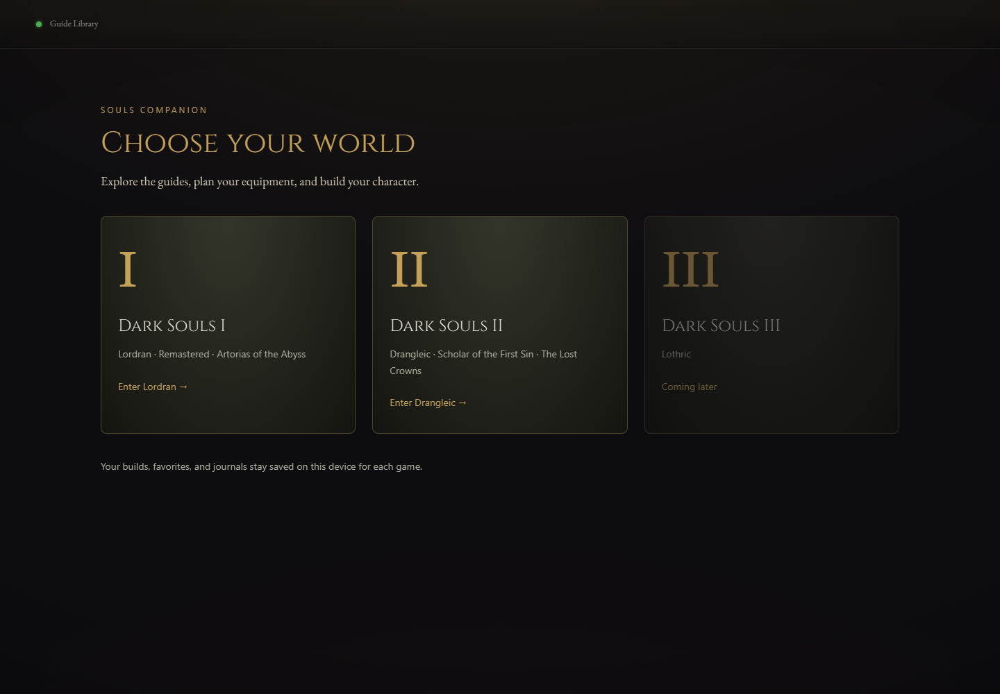

# Souls Companion

**Know your world. Plan your equipment. Build your character.**

### [Open the live guide →](https://milak-web.github.io/souls-companion/)

[](https://github.com/milak-web/souls-companion/actions/workflows/pages.yml)

A mobile-friendly Dark Souls companion with reference guides, a blacksmith simulator, and a character lab in one interface. Choose **Dark Souls I** or **Dark Souls II** from the opening cards and explore without leaving the guide.



## Explore and plan

| Explore | Plan |
| --- | --- |
| Areas, bonfires, enemies, bosses and characters | Weapon reinforcement, infusion paths and upgrade costs |
| Weapons, armor, items, spells and covenants | Damage channels, scaling and equipment comparison |
| Linked drops, locations and related equipment | Character attributes, armor, rings and supported effects |
| Search, category filters and favorites | Saved builds, build import/export and quest journals |

Dark Souls I includes Remastered and Artorias of the Abyss content. Dark Souls II includes Scholar of the First Sin and the Lost Crowns. **Dark Souls III is planned.**

## On your phone

Open the live guide in Safari, Chrome, or another modern browser. Use **← Games** to switch games and the menu button to expand categories. You can bookmark the guide or add it to your home screen using your browser’s sharing/menu options.

Favorites, builds, filters, and journal progress are stored in your browser on each device. They do not automatically sync between your computer and phone. Export a build from the character lab to move it between devices. The hosted guide needs internet access to load; its content and images are served from this repository without third-party runtime dependencies.

## Run locally

Python 3 is enough; no package installation or build step is required:

```sh
python -m http.server 8765
```

Then open `http://localhost:8765/`. Serve the directory over HTTP rather than opening the HTML file directly, because the guide loads local JSON and ES modules.

## Deploy and maintain

Push to `main` to build and publish through GitHub Actions. The Pages workflow runs `python tools/build_pages.py`, compacts JSON without changing values, and publishes only the application files. Research downloads, maintenance tools, local environments, and screenshots are excluded from the deployed site. Enable **GitHub Actions** as the repository’s Pages source.

The application has one entry point (`index.html`) and one shell/router (`js/main.js`). Game modules own their catalogs and game-specific calculations. All runtime assets use relative paths so the guide works under a GitHub Pages repository URL. Existing DS1 and DS2 bookmarks remain supported.

For data maintenance and verification, see [the tools guide](tools/README.md).

## References and scope

This is an unofficial fan guide. Dark Souls and its game artwork belong to their respective owners. Reference records retain source credits; the archive draws on community wikis including Wikidot, Fandom, Fextralife, and wiki.gg. Generated illustrations are identified where used and are not original game artwork.

The labs show documented attack ratings, reinforcement values and supported stat effects. Final combat damage depends on the target and the attack; some conditional effects and spell interactions are documented rather than simulated. Check in-game behavior when making a build decision.
